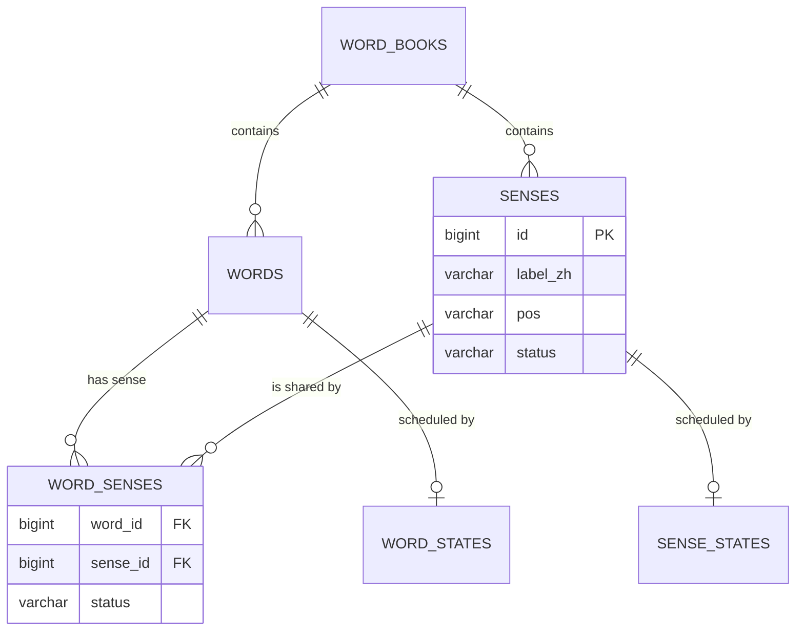

# 词汇—释义二部图：数据表示与可视化

> **本文作用**：说清楚"二部图在数据库里到底长什么样"，并给出可以肉眼核对的图形表示。
> **数据基准**：2026-11-02 重建后的产物（831 义项 / 1,148 条边 / 1,802 个词）。
> **相关文档**：建模原理见 [项目介绍与方案设计.md](项目介绍与方案设计.md) §5.11、§5.14；导入与产物见 `analysis/拆义项与建图产物说明.md`。

---

## 1. 一句话：图存在两张表里

| 图论对象 | 数据库对象 | 说明 |
|---|---|---|
| **左侧顶点**（词汇） | `words` 表的一行 | 已有的词书单词 |
| **右侧顶点**（释义/义项） | `senses` 表的一行 | 一个义项 = 一组同义词共有的那个意思 |
| **边**（词 ↔ 义项） | `word_senses` 表的一行 | `(word_id, sense_id)` 一条边 |
| 等价关系 | **不是边**，是"两个词共享同一个 sense_id" | 所以库里没有"词—词"边表 |

```text
       word_senses（边）
词 ─────────────────── 义项
acclaimed ────────────►「称赞」◄──────── hailed
    ▲                      ▲
    │                      │
  acclaimed 也属于「被广泛赞誉」等其它义项        ← 多义词就是挂在多个义项上的词
```

**关键点**：`senses` 里的一行不是"一个词的一个意思"，而是**一组词共同的那个意思**。
所以 `sense` 的成员 = `SELECT word_id FROM word_senses WHERE sense_id = ?`。

---

## 2. 表结构（迁移 v4 实建）

```sql
-- 右侧顶点：义项
CREATE TABLE senses (
  id             BIGINT PRIMARY KEY AUTO_INCREMENT,
  book_id        BIGINT NOT NULL,              -- 归属词书
  label_zh       VARCHAR(120) NOT NULL,        -- 展示用中文释义（选项文本）
  definition_en  VARCHAR(400) NULL,            -- 英文释义（可选）
  pos            VARCHAR(16) NOT NULL,         -- v/n/adj/adv
  status         VARCHAR(16) NOT NULL,         -- active / needs_review / retired
  merged_into    BIGINT NULL,                  -- 合并痕迹：指向规范义项
  created_at     DATETIME,
  UNIQUE KEY uq_sense_book_label_pos (book_id, label_zh, pos)
);

-- 边：词 ↔ 义项
CREATE TABLE word_senses (
  id          BIGINT PRIMARY KEY AUTO_INCREMENT,
  book_id     BIGINT NOT NULL,
  word_id     BIGINT NOT NULL,                 -- → words.id
  sense_id    BIGINT NOT NULL,                 -- → senses.id
  gloss_raw   VARCHAR(200) NULL,               -- 该词自己的措辞
  status      VARCHAR(16) NOT NULL,            -- active / needs_review / rejected
  UNIQUE KEY uq_word_sense (word_id, sense_id),
  KEY ix_ws_sense_status (sense_id, status),   -- 反查某义项的全部词
  KEY ix_ws_word_status  (word_id, status)     -- 反查某词的全部义项
);

-- 调度挂件：义项卡（FSRS），字段与 word_states 完全一致
CREATE TABLE sense_states (
  id BIGINT PRIMARY KEY AUTO_INCREMENT,
  sense_id BIGINT NOT NULL UNIQUE,             -- 一个义项一张卡
  book_id  BIGINT NOT NULL,
  state SMALLINT, step SMALLINT, stability DECIMAL(12,4), difficulty DECIMAL(12,4),
  reps INT, lapses INT, due DATETIME, last_review DATETIME, status VARCHAR(16)
);
```

### 关系图



`word_senses` 就是二部图的**邻接表**：`(word_id, sense_id)` 一行 = 一条边。

---

## 3. 一个义项星的真实形状

以 `S0022`（义项「尖刻」）为例，数据库里是 1 个义项 + 4 条边 + 5 个词：

```text
                  ┌──────────────┐
                  │ sense S0022  │  label_zh = 尖刻
                  │ pos = adj    │  status = active
                  └──────┬───────┘
        ┌────────┬───────┼────────┬────────┐
        │        │       │        │        │
      acerbic  caustic  harsh  mordant  vitriolic
        └────────┴───────┴────────┴────────┘
             word_senses 里 5 行 (word_id, S0022)
```

对应的原始真题边（`sense_edges.csv` 里的 4 行）：

| 词A | 词B | 义项 |
|---|---|---|
| acerbic | caustic | S0022 |
| acerbic | harsh | S0022 |
| acerbic | vitriolic | S0022 |
| acerbic | mordant | S0022 |

> 5 个词、4 条真题边——边数不必等于词数，一棵树就够把词连成一个义项。

### 多义词的样子

一个词挂在多个义项上，就是二部图里的"度为 2 的点"，它是两个义项星之间的桥：

```text
   S0001「新颖/前所未有」            S0013「独特/不寻常」
   novel  original  innovative       unique  singular  ...
        \      │      /                  \      │
         \     │     /                    \     │
          ─── innovative ──────────────── innovative
                       （同一个词，两条边分别指向两个义项）
```

（示意；真实数据里 `innovative` 同时属于 `S0001` 与 `S0167`。）

---

## 4. 用一条 SQL 把二部图还原出来

```sql
-- ① 某个义项的全部词（取一颗星）
SELECT w.spelling
FROM word_senses ws
JOIN words w ON w.id = ws.word_id
WHERE ws.sense_id = 22 AND ws.status = 'active';

-- ② 某个词的全部义项（多义词的度）
SELECT s.id, s.label_zh, s.pos
FROM word_senses ws
JOIN senses s ON s.id = ws.sense_id
WHERE ws.word_id IN (SELECT id FROM words WHERE spelling = 'innovative')
  AND ws.status = 'active';

-- ③ 等价关系：两个词共享义项（词—词的"投影"，不是存储的边）
SELECT DISTINCT b.word_id
FROM word_senses a
JOIN word_senses b
  ON b.sense_id = a.sense_id AND b.word_id <> a.word_id
WHERE a.word_id = ? AND a.status = 'active' AND b.status = 'active';

-- ④ 全图规模与度分布
SELECT COUNT(*) FROM senses;
SELECT COUNT(*) FROM word_senses;
SELECT c AS sense_degree, COUNT(*) AS senses FROM (
  SELECT sense_id, COUNT(*) c FROM word_senses WHERE status='active' GROUP BY sense_id
) t GROUP BY c ORDER BY c;
```

---

## 5. 当前数据规模

| 指标 | 数值 |
|---|---:|
| 义项顶点 | **831** |
| 边（word_senses） | **1,974**（831 个义项的全部成员；比 1,148 条真题对多，因为一个义项含多个词对） |
| 词汇顶点 | **1,802** |
| 义项规模分布 | 2 词 680、3 词 91、4 词 27、5 词 13、6 词 7、7 词 1、8 词 4、9 词 2、10 词 2、11 词 2、13 词 1、14 词 1 |
| 词所在义项数 | 1 个 **1,632** 词、2 个 **168** 词、3 个 **2** 词（`unexceptional`、`disdain`） |
| 义项卡（sense_states） | 按 `active` 义项建卡 |

> 义项规模的两端含义：2 词星是"孤立的一对"（占 82%），大星通常是被松散边串起来的，已标记 `review` 等人工复核。

---

## 6. 现成的文件（可直接看图 / 可导入）

| 文件 | 内容 | 用途 |
|---|---|---|
| `analysis/senses.csv` | 义项：`义项ID, 锚词, 成员词, 成员数, 中文释义, 状态` | **右侧顶点 + 成员**（一行一颗星） |
| `analysis/sense_edges.csv` | 边：`词A, 词B, 义项ID` | **二部图的来源边**（每条真题对挂到义项） |
| `analysis/pairs_final.csv` | 去重后的 1,148 条词对 | 原始输入 |
| `analysis/jjci_words.json` | 1,457 个词条（释义 + 六选二同义词） | 标签来源 |
| `analysis/sense_pipeline_report.txt` | 构建统计 | 规模快照 |
| `scripts/import_sense_graph.py` | 把上面三份 CSV/JSON 写进数据库 | 建图脚本 |
| 设计文档 §5.11.2 | DDL 与建模约定 | 设计依据 |

**没有专门的图形文件**（没有 Graphviz/JSON 图导出）——本文件就是当前的直观表示。需要导出 `.dot` / `graphml` 时，可按 §4 的 SQL 直接生成。

---

## 7. 怎么自己核对

```bash
# 1) 看某颗星的全部边
python - <<'PY'
import csv
for r in csv.DictReader(open("analysis/sense_edges.csv", encoding="utf-8-sig")):
    if r["义项ID"] == "S0022":
        print(r)
PY

# 2) 看某个词挂在哪几个义项
python - <<'PY'
import csv
want = "innovative"
for r in csv.DictReader(open("analysis/senses.csv", encoding="utf-8-sig")):
    if want in r["成员词"].split("、"):
        print(r["义项ID"], r["成员词"])
PY
```

导入数据库后，把上面换成 §4 的 SQL 即可。
